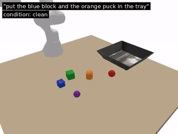
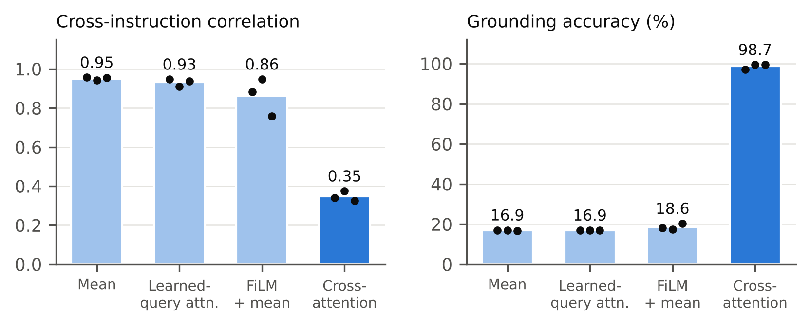

# GRASP: language-conditioned pick-and-place in simulation

An independent, fully reproducible study of language-conditioned pick-and-place:
follow an instruction ("grab the blue tube and drop it in the basket"), find the
object, plan a grasp, and put it in the tray.



The full demo, [`media/demo.mp4`](media/demo.mp4) (30 s), shows two successes
and one real failure.

**Report:** [`paper/main.pdf`](paper/main.pdf)

## What it does

```
instruction ──► parser ──► targets (colour, shape)
                                   │
overhead RGB-D ──► detection ──► grounding ──► clearance-aware grasp planner ──► Panda arm
               (depth blobs +    (which blob    (finger opening + wrist angle
                colour split)     is "it"?)      that avoids neighbours)
```

- **Simulator** (`grasp_vla/sim.py`): PyBullet, a Franka Panda, a tray, and random
  cubes, cylinders and balls in six colours. It can add clutter, depth noise,
  camera miscalibration and low friction.
- **Perception** (`perception.py`): depth points become connected components,
  and components holding two colour clusters are split. The simulator's
  ground truth is used only for scoring.
- **Grounding** (`grounding.py`): colour and shape attributes. An optional CLIP
  grounder handles open vocabulary. `learned.py` holds a trained policy.
- **Grasp planning** (`grasp_planning.py`): chooses the finger opening and wrist
  angle with the fewest obstacle points under the fingers.
- **Planner** (`language.py`): rule-based by default. An optional LLM planner is
  not used for any reported number.

## Results

### Pick-and-place: 200 fresh scenes per condition (seeds 3000–3199)

| Condition | Full pipeline | Simple grasp planner | Depth-only segmentation |
|---|---|---|---|
| Clean (5 objects) | 100% | 100% | 100% |
| Clutter (8 objects, gaps down to 8 mm) | **99.5%** | 97.5% | 92.5% |
| Sensor noise (2 mm depth, 6 mm calibration error) | 100% | 100% | 100% |
| Low friction (μ 0.3–0.6) | 100% | 100% | 100% |
| Combined | **99.0%** | 98.0% | 90.5% |

Colour splitting removes almost all wrong-object errors in clutter (14 down to 1).
The clearance-aware planner's gain at these spacings is within the 95%
confidence intervals. The stress sweep below shows where each version breaks.

### Where it breaks: stress sweep (100 scenes per point, seeds 5000–5099)

| Knob | Level → success (clearance-aware planner) |
|---|---|
| Gap between 8 objects | 30 mm 98% · 15 mm 100% · 8 mm 100% · 4 mm 99% · 1 mm 97% |
| Camera calibration error (std) | 0 mm 100% · 5 mm 100% · 10 mm 96% · 15 mm 71% · 20 mm 52% · 30 mm 29% |

Camera calibration is the weak point: almost every failure there is a grasp miss.
The two grasp planners perform the same within noise. The clearance-aware planner
is slightly worse under large calibration error, because its narrower finger
opening leaves less room for position error.

### Cross-attention pooling (300 held-out scenes, 1,785 instructions, 3 seeds)

A small learned grounding policy sees one token per detected object and must
point at the object named in the instruction. Only the pooling step differs
between variants.

| Pooling | Cross-instruction correlation ↓ | Grounding accuracy ↑ | Median error |
|---|---|---|---|
| Mean | 0.951 | 16.9% | 129 mm |
| Attention, learned query | 0.932 | 16.9% | 129 mm |
| FiLM + mean | 0.863 | 18.6% | 125 mm |
| **Cross-attention** | **0.348** | **98.7%** | **4.5 mm** |

Chance level is 16.8%. Cross-attention cuts the correlation by **63%**, and it is
the only variant that learns the task within the 12-epoch budget. Trained for 40 epochs, FiLM reaches 61%, while mean pooling stays at chance even as its correlation drops to 0.59, so correlation alone is not proof of grounding. Inside the
robot loop on 100 cluttered scenes, it succeeds in **94%** of episodes. The other
learned variants reach 6–8%, and the hand-written grounder reaches 99%.
*Cross-instruction correlation* is the mean pairwise correlation between the
fused representations of one scene under different instructions. The report
defines it and discusses why it should be read alongside accuracy.




## Reproduce

```bash
pip install -r requirements.txt
python -m pytest -q tests                                   # 35 tests, ~10 s
python experiments/grasp_eval.py --episodes 200 --seed0 3000                  # ~8 min on 2 cores
python experiments/grasp_eval.py --episodes 200 --seed0 3000 --grasp-planner simple
python experiments/grasp_eval.py --episodes 200 --seed0 3000 --no-color-split
python experiments/pooling_data.py && python experiments/pooling_train.py     # ~1 h on CPU
python experiments/learned_in_loop.py && python experiments/stress_sweep.py
python experiments/make_figures.py && python experiments/make_video.py
```

## Limitations

- The objects are simple primitives with top-down grasps in simulation only, so
  high success rates here say little about real objects.
- The default grounder only knows the six colours and three shapes. The CLIP
  grounder is implemented but untested, because its weights could not be
  downloaded in the environment used.
- "Cross-instruction correlation" is defined in the report and should be read
  together with grounding accuracy.

## AI use

Code and report were developed with AI
assistance (Claude). I directed the work and take responsibility for the results.
